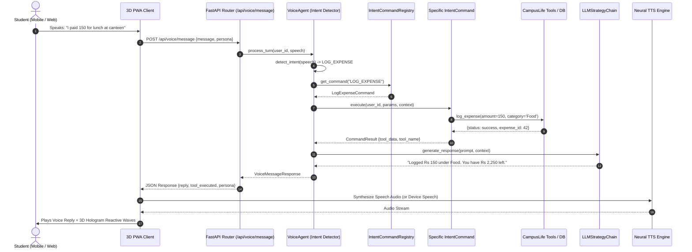
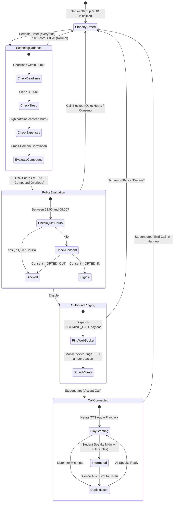

# CampusLife AI — UML Diagrams & Architecture Models

**Document Version:** 2.0  
**Specification:** Unified Modeling Language (UML 2.5)  
**Standard:** IEEE 42010 Architecture Description  

---

## 1. Sequence Diagram: Voice Query & Tool Execution

### 1.1 Mermaid Diagram


### 1.2 ASCII Sequence Diagram
```
Student           3D PWA Client       FastAPI Router        VoiceAgent       IntentRegistry        Tools/DB
   │                     │                   │                   │                  │                  │
   │── Spoken Query ────>│                   │                   │                  │                  │
   │                     │── POST /message ─>│                   │                  │                  │
   │                     │                   │── process_turn ──>│                  │                  │
   │                     │                   │                   │── detect_intent ─>                  │
   │                     │                   │                   │── get_command ──>│                  │
   │                     │                   │                   │<─ CommandObj ────│                  │
   │                     │                   │                   │── execute() ───────────────────────>│
   │                     │                   │                   │<─ Result ───────────────────────────│
   │                     │                   │<─ JSON Response ──│                                     │
   │                     │<─ JSON + Reply ───│                                                         │
   │<── Audio Speech ────│                                                                             │
```

---

## 2. Class Diagram: Design Patterns Implementation

### 2.1 Strategy, Observer, and Command Pattern Architecture

```mermaid
classDiagram
    %% Strategy Pattern for LLM Engines
    class LLMStrategy {
        <<interface>>
        +name: str
        +is_available() bool
        +generate(system_prompt, user_prompt, max_tokens) Optional~str~
    }
    class OllamaStrategy {
        +base_url: str
        +model: str
        +is_available() bool
        +generate(...) Optional~str~
    }
    class OpenAIStrategy {
        +api_key: str
        +model: str
        +is_available() bool
        +generate(...) Optional~str~
    }
    class LocalDomainStrategy {
        +is_available() bool
        +generate(...) Optional~str~
    }
    class LLMStrategyChain {
        -strategies: List~LLMStrategy~
        +generate_response(...) str
        +get_active_strategy_name() str
    }
    LLMStrategy <|.. OllamaStrategy
    LLMStrategy <|.. OpenAIStrategy
    LLMStrategy <|.. LocalDomainStrategy
    LLMStrategyChain o-- LLMStrategy

    %% Observer Pattern for Alerts
    class AlertObserver {
        <<interface>>
        +on_alert(alert_type, payload) Coroutine
    }
    class WebSocketAlertObserver {
        -connection_manager: MobileCallManager
        +on_alert(alert_type, payload) Coroutine
    }
    class TelegramAlertObserver {
        -bot_service: TelegramVoiceService
        +on_alert(alert_type, payload) Coroutine
    }
    class DeadlineWatcherSubject {
        -observers: List~AlertObserver~
        +subscribe(observer)
        +unsubscribe(observer)
        +notify(alert_type, payload) Coroutine
    }
    AlertObserver <|.. WebSocketAlertObserver
    AlertObserver <|.. TelegramAlertObserver
    DeadlineWatcherSubject o-- AlertObserver

    %% Command Pattern for Intent Dispatching
    class IntentCommand {
        <<interface>>
        +intent_name: str
        +tool_name: str
        +execute(user_id, params, context) Dict
    }
    class CreateTaskCommand {
        +execute(user_id, params, context) Dict
    }
    class LogExpenseCommand {
        +execute(user_id, params, context) Dict
    }
    class LogSleepCommand {
        +execute(user_id, params, context) Dict
    }
    class IntentCommandRegistry {
        -commands: Dict~str, IntentCommand~
        +register(command)
        +get(intent_name) IntentCommand
        +execute_intent(intent_name, ...) Dict
    }
    IntentCommand <|.. CreateTaskCommand
    IntentCommand <|.. LogExpenseCommand
    IntentCommand <|.. LogSleepCommand
    IntentCommandRegistry o-- IntentCommand
```


---

## 3. State Machine Diagram: Calling Sentinel & Student State

### 3.1 Sentinel State Machine


---

## 4. Component Diagram: System Architecture

```mermaid
graph TB
    subgraph Client Tier [Progressive Web App & Native Mobile]
        PWA[Mobile PWA Client\n(Service Worker, Manifest)]
        WebGL[Three.js 3D WebGL\n(Hologram Neural Core)]
        Audio[Web Audio API &\nFull-Duplex Speech STT/TTS]
    end

    subgraph API Tier [FastAPI REST & WebSocket Gateway]
        Router[API Routers\n(/api/study, /api/health, /api/voice...)]
        WSGateway[WebSocket Signaling Gateway\n(/api/voice/call-stream/{id})]
        AuthMiddleware[Bearer Token JWT Authentication]
    end

    subgraph Service Tier [Business Logic & Intelligence]
        Intelligence[Module 6: Student Intelligence\n(Compound Overload Engine)]
        StudySvc[Module 2: Study Planner Service]
        HealthSvc[Module 3: Health & Wellness Service]
        ExpenseSvc[Module 4: Financial Manager Service]
        TravelSvc[Module 5: Travel Planner Service]
        VoiceSvc[Module 7: Voice Companion & Policy Engine]
    end

    subgraph Data & Storage Tier
        SQLite[(SQLite Relational Database\nSQLAlchemy ORM)]
        Cache[(PWA Offline Cache Storage)]
    end

    subgraph External Infrastructure
        Ollama[Local Ollama / Llama 3.2]
        OpenAI[OpenAI Cloud API (Optional)]
        Telegram[Telegram Bot Telephony Gateway]
        Cloudflare[Cloudflare Tunnel / Static Domain]
    end

    PWA -->|HTTPS / REST| Router
    PWA <-->|WSS Dual Stream| WSGateway
    Router --> Service Tier
    Service Tier --> SQLite
    VoiceSvc --> Ollama
    VoiceSvc --> OpenAI
    VoiceSvc --> Telegram
    Cloudflare -.-> Router
```
